# ReachInbox - Cold Email Outreach Scheduler

A full-stack cold email scheduler built with **Node.js, TypeScript, Express, PostgreSQL, Prisma, Redis, BullMQ, Nodemailer, Elasticsearch, Google OAuth 2.0, Slack OAuth 2.0**, and **React + Vite + Tailwind CSS**.

The system avoids cron jobs and polling loops, using BullMQ delayed queues backed by Redis, atomic distributed send spacing, and windowed hourly quotas.

---

## Architecture Overview

```mermaid
flowchart TD
    subgraph Frontend["React + TypeScript + Vite + Tailwind CSS"]
        UI["Outreach Dashboard"]
        Compose["Campaign Composer (CSV/TXT Parser)"]
        SearchBox["Email Search Bar"]
    end

    subgraph API["Express.js API Server (:4000)"]
        AuthCtrl["Auth (Google OAuth 2.0)"]
        EmailCtrl["Email Endpoints"]
        SlackCtrl["Slack OAuth & Alerts"]
        Board["Bull Board Dashboard (/admin/queues)"]
    end

    subgraph Storage["Databases & Queues"]
        PG[("PostgreSQL\n(Prisma ORM)")]
        RedisDB[("Redis\n(BullMQ & Rate Limits)")]
        ES[("Elasticsearch\n(Search Index)")]
    end

    subgraph WorkerProcess["BullMQ Worker"]
        Worker["EmailWorker (Configurable Concurrency)"]
        Spacing["Distributed Send Spacing"]
        HourlyRate["Hourly Quota Limiter"]
        SMTP["Nodemailer (Ethereal / SMTP)"]
        Recovery["RecoveryService (Startup Sync)"]
    end

    subgraph External["Third-Party Services"]
        GoogleAuth["Google Cloud Identity"]
        SlackAPI["Slack Bot API"]
        Ethereal["Ethereal Test Inboxes / SMTP"]
    end

    UI -->|Session Cookie / REST API| API
    AuthCtrl <-->|OAuth2 Token Verify| GoogleAuth
    AuthCtrl --> PG
    EmailCtrl -->|Save Schedule & Jobs| PG
    EmailCtrl -->|Deterministic Job IDs| RedisDB
    Worker -->|Fetch Pending Jobs| PG
    Worker -->|Check Spacing & Quota| RedisDB
    Worker -->|Exhausted Quota Alert| SlackAPI
    Worker -->|Send Email| Ethereal
    Worker -->|Update Status| PG
    Worker -->|Index Email| ES
    SearchBox -->|Query /api/emails/search| EmailCtrl
    EmailCtrl -->|Search Fallback to PG| ES
    Recovery -->|Reconcile Missing Jobs| RedisDB
```



---

## Tech Stack

| Layer | Tools & Libraries |
| :--- | :--- |
| **Backend** | Node.js (v20+ / v22+), TypeScript, Express.js, Cookie-Parser, CORS, Multer |
| **Queue & Scheduling** | BullMQ (Delayed Jobs, Deterministic IDs, Zero Crons), ioredis |
| **Database & ORM** | PostgreSQL, Prisma ORM |
| **Email Delivery** | Nodemailer (Ethereal SMTP sandbox & Custom SMTP support) |
| **Search Engine** | Elasticsearch (with automatic PostgreSQL full-text search fallback) |
| **Authentication** | Google OAuth 2.0 (`google-auth-library`), Signed JWT Cookies |
| **Notifications** | Slack OAuth 2.0 (`chat:write`), Redis-backed alert deduplication |
| **Queue Monitoring** | Bull Board (`@bull-board/express`) |
| **Frontend** | React 18, TypeScript, Vite, Tailwind CSS, Lucide React, Axios |
| **Testing** | Vitest (Unit & Integration tests) |

---

## Project Structure

```
reachinbox-scheduler/
├── backend/
│   ├── prisma/
│   │   └── schema.prisma           # Prisma schema (User, Schedule, Job, Sender, Slack)
│   ├── src/
│   │   ├── config/                 # Env variables, Prisma client, Redis connection
│   │   ├── controllers/            # Auth, Email, Sender, and Slack route controllers
│   │   ├── middleware/             # Cookie session authentication guard
│   │   ├── routes/                 # Express API routes
│   │   ├── services/               # BullMQ queue, email sender, rate limiter, CSV parser, Slack
│   │   ├── workers/                # BullMQ worker process
│   │   ├── types/                  # TypeScript interfaces and domain types
│   │   ├── scripts/                # Ethereal account creation & DB clear scripts
│   │   ├── app.ts                  # Express app setup and Bull Board mount
│   │   └── server.ts               # API server entrypoint
│   ├── tests/                      # Vitest test suites (CSV parsing, rate limits, crypto, scheduling)
│   ├── package.json
│   ├── tsconfig.json
│   └── .env.example
├── frontend/
│   ├── src/
│   │   ├── components/             # Reusable UI components (Tables, Modals, Inputs, Buttons)
│   │   ├── pages/                  # Dashboard and Login pages
│   │   ├── services/               # Axios API client
│   │   ├── types/                  # Frontend interfaces
│   │   ├── App.tsx                 # Route guards and authentication state
│   │   ├── main.tsx                # Entry point
│   │   └── index.css               # Tailwind CSS theme
│   ├── package.json
│   ├── tsconfig.json
│   ├── vite.config.ts
│   └── .env.example
├── package.json                    # Root workspace package orchestrator
├── README.md
└── .gitignore
```

---

## Local Setup Guide

### 1. Prerequisites
- **Node.js**: v20 or v22 ([nodejs.org](https://nodejs.org/))
- **PostgreSQL**: Running locally on port `5432` ([postgresql.org](https://www.postgresql.org/))
- **Redis**: Running locally or via free cloud instance ([Upstash](https://upstash.com/))

### 2. Environment Configuration
Copy `backend/.env.example` to `backend/.env`:
```powershell
cp backend/.env.example backend/.env
```

Fill in your configuration:
- `DATABASE_URL`: Your PostgreSQL connection string.
- `REDIS_URL`: Your Redis connection string (`redis://127.0.0.1:6379` or Upstash TLS URL).
- `GOOGLE_CLIENT_ID` & `GOOGLE_CLIENT_SECRET`: From Google Cloud Console.
- `ETHEREAL_USER` & `ETHEREAL_PASSWORD`: Generated using the command below.

### 3. Install Dependencies & Generate Test Accounts
```powershell
# Install all packages
npm install

# Generate Ethereal SMTP test credentials
npm run create:ethereal --workspace=backend

# Push Prisma schema to PostgreSQL
npm run prisma:push --workspace=backend
```

### 4. Run Tests & Typechecks
```powershell
# Run backend test suite
npm run test

# Run TypeScript checks
npm run typecheck

# Build both frontend and backend
npm run build
```

### 5. Start Development Server
```powershell
# Starts API (:4000), BullMQ Worker, and Frontend (:5173) concurrently
npm run dev
```

Alternatively, you can run each service in its own terminal:
- **API Server**: `npm run dev:backend`
- **Worker Process**: `npm run dev:worker`
- **Frontend**: `npm run dev:frontend`

---

## Key Features & Design Choices

### 1. BullMQ Delayed Queues (Zero Crons)
- Scheduling uses BullMQ delayed jobs instead of cron polling loops.
- When an outreach campaign is submitted:
  - Records are stored in PostgreSQL with target send timestamps (`scheduledAt`).
  - Jobs are enqueued into BullMQ with deterministic IDs (`jobId = "email-job-" + id`) and a millisecond delay (`scheduledAt - Date.now()`).
  - This avoids duplicate enqueueing and eliminates polling overhead on the database.

### 2. Distributed Send Spacing & Rate Limiting
- **Send Spacing**: Ensures a minimum gap (e.g., 2 seconds) between consecutive emails per sender using atomic Redis locks.
- **Hourly Quotas**: Tracks per-sender limits inside the current UTC hour window (`email-rate:{senderId}:{window}`). If the limit is hit:
  - Jobs are deferred to the start of the next hour window.
  - No emails are dropped.
  - A Slack alert notification is triggered.

### 3. Worker Crash Recovery
- PostgreSQL acts as the source of truth.
- On startup, `RecoveryService.reconcilePendingJobs()` checks for pending jobs that were scheduled but not present in the queue (e.g., after an unexpected crash) and re-enqueues them with their remaining delay.

### 4. Search with Fallback
- Full-text search searches across recipient, subject, and body.
- When Elasticsearch is available, it queries the index.
- If Elasticsearch is offline or not installed, it automatically falls back to PostgreSQL without breaking the dashboard.

### 5. Bull Board Monitoring
Bull Board is mounted at:
```
http://localhost:4000/admin/queues
```
Allows visual inspection of Active, Delayed, Waiting, Completed, and Failed jobs.

---

## Testing & Verification

Run the test suite:
```powershell
npm run test
```

Tests cover:
- CSV/TXT parsing and deduplication (`recipientParser.test.ts`)
- Rate limiting and hourly quota calculations (`rateLimitService.test.ts`)
- Delayed scheduling and dependency injection (`scheduling.test.ts`)
- AES-256-GCM encryption and decryption roundtrips (`cryptoService.test.ts`)

---

## Assumptions, Shortcuts & Trade-offs

### 1. Assumptions
- **SMTP Transport**: Configured for Ethereal Email sandbox test dispatch per assignment guidelines. Real SMTP servers (e.g. Gmail) can be enabled simply by updating environment variables.
- **Time Zones**: All scheduling, rate limit windows, and delay math are calculated in UTC to guarantee consistency across different client regions and server instances.
- **Single Source of Truth**: PostgreSQL is the permanent system of record. Redis and BullMQ act as transient queue and coordination engines.

### 2. Shortcuts
- **PostgreSQL Search Fallback**: Running local Elasticsearch clusters on Windows without Docker can be resource-heavy. The search service transparently queries PostgreSQL with `contains` / `ILIKE` if Elasticsearch is not running locally.
- **ISP Port 587 Fallback**: Domestic ISPs often block outbound SMTP port 587 to foreign IPs. The email sender intercepts connection timeouts gracefully and simulates successful dispatch so local testing never gets stuck on network timeouts.

### 3. Trade-offs
- **Worker-Level Send Spacing vs Queue Serialization**: Send spacing is enforced dynamically at worker dispatch using Redis locks rather than serializing all jobs into a single thread. This allows high worker concurrency across multiple senders while keeping strict per-sender delay gaps.
- **Startup Reconciliation vs Direct Polling**: Avoided continuous polling loops entirely. Instead, BullMQ delayed queues handle timing, and a one-time `RecoveryService` sync runs on startup to reconcile any database jobs that were in-flight during a crash.

